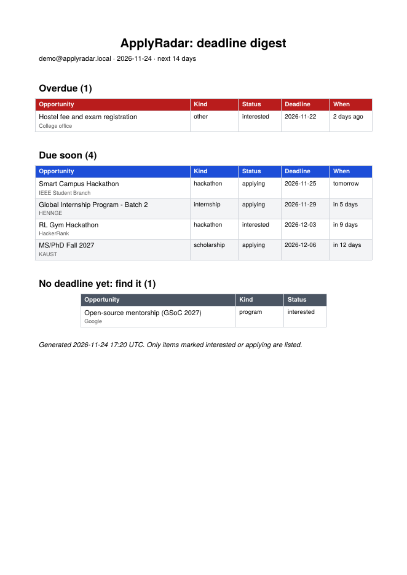

# ApplyRadar

**Every application deadline in one place, read for you by AI, and a PDF every morning listing what's due.**

As a final-year student I track internships, scholarships, hackathons and fellowships that arrive as forwarded WhatsApp messages, emails and portal pages. The deadline is buried in a paragraph next to the event date and the results date, and finding it again a week later means scrolling back through all of it. ApplyRadar turns "paste the announcement" into a tracked item with its real application deadline, and a scheduled job builds a PDF every morning listing what's overdue and what's due in the next 14 days.

FlyRank Backend AI Engineering capstone: **Your 10x Solution**. The problem statement and implementation write-up are in [My 10x Solution - Mohamed Ibrahim Abdullah.md](My%2010x%20Solution%20-%20Mohamed%20Ibrahim%20Abdullah.md).



## Run it (two commands after setup)

Requires Python 3.10+.

```bash
pip install -r requirements.txt
cp .env.example .env        # then set JWT_SECRET (the file says how to generate one)
python seed.py              # demo account + 8 opportunities with deadlines relative to today
uvicorn app.main:app        # http://localhost:8000/docs
```

**AI extraction** needs a model. The default is [Ollama](https://ollama.com) on your machine (free, no key): `ollama pull qwen3.5`. Any OpenAI-compatible provider works by changing `LLM_BASE_URL`, `LLM_API_KEY` and `LLM_MODEL`. With no model at all, set `LLM_STUB=1`: extraction returns a fixed placeholder and everything else works normally.

## 5-minute demo path

1. `python seed.py`, then `uvicorn app.main:app`, then open <http://localhost:8000/docs>.
2. **POST /auth/login** → Try it out → `{"email": "demo@applyradar.local", "password": "demo-password-123"}` → copy `access_token`.
3. Click **Authorize** (top right), paste the token. Every padlocked route now works. Without the token they all return 401.
4. **GET /opportunities**: 8 seeded items, soonest deadline first, undated ones last.
5. **GET /digest**: one item overdue (2 days ago), four due in the next 14 days with `days_left`, one with no deadline. The day counts are computed in code, not by the model.
6. **POST /opportunities/extract**: paste this (the example in Swagger is prefilled):
   `*Fwd* CodeStorm 24-hr hackathon @ PSG Tech! Event on 14th Dec. Last date to register 6th dec. Reg link: bit.ly/codestorm26`
   → 201, and the new item has `"deadline": "2026-12-06"`, which is the registration date, not the 14 Dec event date. Add `?save=false` to preview without saving.
7. **PATCH /opportunities/{id}** with `{"status": "applied"}`. Applied items drop out of the digest.
8. **POST /reports/digest**, then **GET /reports/latest** → download the PDF. The same PDF is built for every user automatically at 07:30 (`GET /health` shows `next_digest_run`).

## Concepts → code

6 of the 7 concepts, no swaps.

| Concept | Where | What it does here |
|---|---|---|
| **API endpoints** | `app/main.py` | 13 routes, Pydantic validation with `extra="forbid"`, consistent `{"error": ...}` bodies; 201/204/400/401/404/409/422/502/503/504 |
| **Database** | `app/db.py` | SQLite with foreign keys, CHECK constraints for `kind`/`status`, an index on `(user_id, deadline)`. Every opportunity query is scoped by `user_id`. |
| **Authentication** | `app/auth.py` | bcrypt password hashes, HS256 JWTs with expiry, one `current_user` dependency on every private route; constant-time-ish login for unknown emails |
| **Background job** | `app/jobs.py` | APScheduler cron inside the API process: daily digest PDF for every user at `DIGEST_CRON` in `APP_TIMEZONE`. One user's failure doesn't stop the rest. |
| **Reporting (PDF)** | `app/reports.py` | ReportLab one-pager: overdue / due soon / no deadline yet; user text is escaped before rendering |
| **LLM integration** | `app/llm/`, `prompts/extract-v1.md` | One job (announcement → title, organisation, kind, deadline, url, confidence), validated, one repair, quarantine, cost log, stub and kill switch |

Not used: caching. Nothing here is slow or repeated enough to need it yet (see Future ideas).

## How the AI part stays honest

- **Schema first.** `kind` is an enum, unknown fields are rejected, and `deadline` must be a real calendar date (`2027-02-30` fails).
- **Facts are checked against the source.** If the model returns a `url` that doesn't appear in the pasted text, that's a validation failure, because a guessed link is worse than none. The model gets one repair attempt with the exact error.
- **Two failures → 422**, and the input, both outputs and both errors go to `logs/quarantine.jsonl`. Raw model text is never returned.
- **Pasted text is data.** It's JSON-encoded in the user message, never placed in the system prompt.
- **Code does the arithmetic.** The model only copies the deadline; `days_left`, overdue and due-soon are computed in `reports.py`.
- **Ops.** Explicit 30 s timeout, retries only on timeout/429/5xx with backoff + jitter (never on 401/403), one cost-log line per call, `LLM_ENABLED=false` kill switch → 503.

Real run (qwen3.5 on Ollama, 24 Nov 2026, `scripts/try_extract.py`):

| Pasted text (abridged) | Result |
|---|---|
| MSR India PhD Fellowship… "by 30 January 2027 via https://aka.ms/…" | scholarship, `2027-01-30`, url copied, 0.95 |
| CodeStorm hackathon… "Event on 14th Dec… Last date to register 6th dec… bit.ly/codestorm26" | hackathon, `2026-12-06` (not the event date), 0.95 |
| "guest lecture on cloud security on Friday… attendance mandatory" | `other`, no deadline, confidence 0.2 (correctly not an opportunity) |

Cost log for one call: `{"prompt_version": "extract-v1", "model": "qwen3.5", "input_tokens": 797, "output_tokens": 67, "duration_ms": 12040, "repairs": 0, "outcome": "ok"}`. That's $0 locally, and about 12 s on a laptop.

## Tests

```bash
pip install -r requirements-dev.txt
pytest -q        # 21 tests, no network: the model is a scripted fake
```

They cover: signup/login/duplicates; 401 for missing, garbage and **forged-signature** tokens; **user A can't read, change or delete user B's items** (404, not 403, so ids don't leak); CRUD, sorting and validation; extraction save vs preview; an invented URL getting repaired; an impossible date twice → 422 + quarantine; the kill switch; digest buckets and day counts; the PDF round trip, including markup characters in titles; and the scheduled job writing one report per user.

## Security notes

- No secrets in the repo: `.env` is gitignored, and the app refuses to start unless `JWT_SECRET` is at least 32 characters.
- Every SQL query is parameterised. Column names in the two dynamic queries come from a fixed allow-list, never from the request.
- The seed data is invented: real organisation names, made-up deadlines relative to today. There's no one else's personal data.

## Future ideas (out of scope on purpose)

- Email the digest (SMTP / free tier) instead of only storing the PDF.
- Paste a URL instead of text: fetch the page, then extract (scraping concept).
- Cache extraction results by text hash, so re-pasting the same forward is free and instant.
- Reminders at T-7 / T-2 / T-0 days instead of one daily digest.
- Deploy on a free tier, which would need persistent storage for SQLite and the PDFs.

**Non-goal:** it is not an application tracker for *writing* applications (essays, CV versions). It tracks deadlines and status only.
